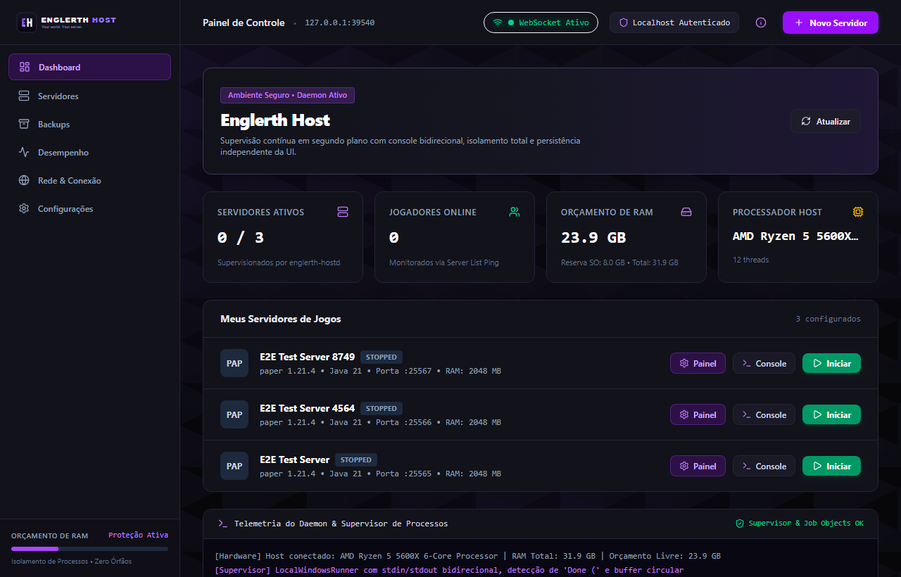
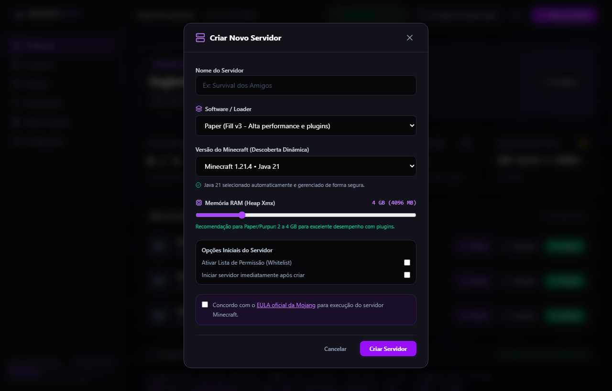
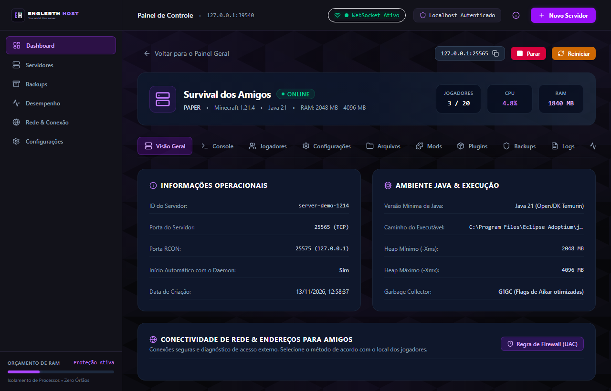
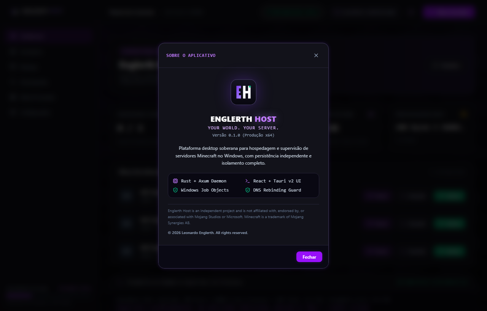

<div align="center">

# Englerth Host

<p align="center">
  <strong>Your world. Your server.</strong>
</p>

<p align="center">
  
</p>

<p align="center">
  Plataforma desktop para hospedagem, supervisão e gerenciamento autônomo de servidores Minecraft no Windows.
</p>

<p align="center">
  
  
  
  
</p>

</div>

---

> [!IMPORTANT]
> ### 🛡️ Aviso de Software Proprietário e Direitos Autorais
> O **Englerth Host** é um produto de software comercial e proprietário desenvolvido por **Leonardo Englerth**.  
> **O código-fonte da aplicação NÃO é de código aberto (open source) e NÃO está disponível publicamente para download, clonagem ou redistribuição gratuita.**  
> Este repositório tem como finalidade exclusiva a **apresentação institucional, demonstração visual e documentação pública de funcionalidades** da plataforma.  
> Todos os direitos são estritamente reservados. Para parcerias, licenciamento ou aquisição comercial, consulte os canais oficiais na seção de contato.

---

## 📸 Demonstração Visual das Interfaces (Dark Purple)

A plataforma conta com uma interface desktop escura (*Dark Purple*), com acabamento em grafite profundo, reflexos e acentos em roxo vibrante, inspirada em padrões visuais como Linear, Raycast e Discord.

### 🖥️ Dashboard Central de Operações
Visualização consolidada de todos os servidores locais, status em tempo real, consumo de memória RAM, alocação de núcleos e acesso rápido com 1 clique.


---

### ⚡ Assistente de Criação e Provisionamento Dinâmico
Provisionamento automatizado com descoberta de versões em tempo real para múltiplos provedores oficiais e gerenciamento autônomo de runtimes Java.


---

### 🎛️ Painel Central do Servidor e Console Interativo
Gerenciamento individualizado por servidor com 10 abas operacionais especializadas, console bidirecional ao vivo com buffer circular, histórico de comandos e autocompletar.


---

### ℹ️ Arquitetura e Janela "Sobre o Aplicativo"
Diálogo informativo com especificações de versão, slogan, créditos e detalhes da arquitetura em camadas desacopladas.


---

## ✨ Principais Funcionalidades da Plataforma

- **Suporte Multiprovedores Nativos:**
  - Provisionamento automatizado e verificação criptográfica SHA-256 para: **Paper**, **Purpur**, **Vanilla Oficial (Mojang)**, **Fabric**, **Quilt**, **NeoForge**, **Minecraft Forge** e **Spigot**.
- **Gerenciador de Java Integrado:**
  - Detecção e download sob demanda de runtimes Eclipse Adoptium Temurin (Java 8, 17, 21 e 25), confinados na pasta de dados da aplicação sem alterar o `PATH` do Windows.
- **Supervisor Desacoplado Resiliente:**
  - O daemon atua como processo pai independente da interface gráfica. Se o painel for fechado, os servidores continuam em execução normalmente.
  - Confinamento por **Windows Job Objects**, garantindo encerramento limpo e impedindo processos Java órfãos na finalização do serviço.
- **Console Bidirecional em Tempo Real:**
  - Envio de comandos via `stdin` e captura contínua de logs via WebSockets locais, com retenção circular de 1.000 linhas e arquivo em disco.
- **Backups Atômicos a Quente:**
  - Criação de snapshots compactados `.zip` com suspensão atômica de disco (`save-off` / `save-all flush`), guarda RAII para restauração incondicional (`save-on`) e integridade SHA-256.
- **Confinamento em Sandbox de Arquivos:**
  - Gerenciador de arquivos integrado com bloqueio absoluto de *Path Traversal* (`../`) e junctions/symlinks que apontem para fora do servidor.
- **Diagnóstico de Conectividade e CGNAT:**
  - Detecção proativa de conexões sob CGNAT (RFC 6598) e rotas guiadas de conectividade para amigos (LAN, Tailscale, ZeroTier e túneis dedicados).
- **Proteção do Computador e Modo Jogo:**
  - **Game Mode:** Rebaixa dinamicamente a prioridade dos servidores Java quando o administrador estiver jogando no computador hospedeiro.
  - **Prevenção de Suspensão:** Mantém o computador ativo (`SetThreadExecutionState`) enquanto houver servidores ligados, sem modificar planos de energia ou BIOS.
- **Ecossistema de Mods, Plugins e Modpacks:**
  - Leitor in-memory de metadados (`fabric.mod.json`, `mods.toml`, `plugin.yml`), motor de resolução de compatibilidade e importador de pacotes `.mrpack` e CurseForge.
- **Integração Bedrock e GeyserMC:**
  - Suporte ao Bedrock Dedicated Server oficial e ativação em 1-clique do GeyserMC + Floodgate para crossplay entre Java e Bedrock (celular/console).
- **Notificações por Webhook:**
  - Alertas automáticos no Discord para servidores iniciados, desligados, paradas inesperadas e backups concluídos.

---

## 🏛️ Visão Conceitual da Arquitetura

```
+-------------------------------------------------------------------+
|               Interface Desktop (Tauri v2 + React)                |
|             Identidade Dark Purple • Tokens High-Contrast         |
+---------------------------------+---------------------------------+
                                  |
               Loopback Restrito  |  Origem: tauri.localhost
             (127.0.0.1:39540)    |  Token Bearer em Disco Confinado
                                  v
+-------------------------------------------------------------------+
|               Daemon Supervisor Rust (englerth-hostd)              |
|        Axum • Tokio • SQLite • Job Objects • Proteção DNS         |
+---------------------------------+---------------------------------+
                                  |
         +-------------------------+-------------------------+
         |                         |                         |
         v                         v                         v
+---------------+         +---------------+         +---------------+
| Servidor #1   |         | Servidor #2   |         | Servidor #3   |
| Paper 1.21.4  |         | Fabric 1.20.1 |         | Forge 1.12.2  |
| OpenJDK 21    |         | OpenJDK 17    |         | OpenJDK 8     |
+---------------+         +---------------+         +---------------+
```

---

## 🔒 Compromisso de Segurança e Confinamento

O Englerth Host foi concebido com regras de integridade inegociáveis:
1. **Confinamento Absoluto:** Trabalha exclusivamente dentro de sua pasta de dados locais isolada. Nunca modifica outros launchers, jogos existentes ou arquivos pessoais fora de seu diretório.
2. **Respeito ao Sistema Operacional:** Não desativa antivírus ou firewall, não altera BIOS nem configurações de registro do Windows.
3. **Sem Abertura Silenciosa de Portas:** Não utiliza UPnP e não executa comandos administrativos sem consentimento explícito.
4. **Isolamento de RCON e Credenciais:** RCON estritamente vinculado a `127.0.0.1` com chaves criptográficas aleatórias geradas dinamicamente. Proteção ativa contra ataques de DNS Rebinding.

---

## 📁 Organização de Materiais Visuais

Os materiais visuais desta apresentação pública estão organizados na pasta `assets/`:

```
Englerth-Host/
├── README.md                  # Apresentação comercial da plataforma
├── NOTICE                     # Declaração oficial de direitos autorais e confidencialidade
├── SECURITY.md                # Política de segurança e reporte de vulnerabilidades
└── assets/
    ├── logo/                  # Logotipos oficiais, variantes vetoriais e favicon
    ├── screenshots/           # Capturas de tela em alta resolução das interfaces
    ├── dashboard/             # Prints específicos do painel geral de operações
    ├── interfaces/            # Prints dos assistentes, abas e diálogos do sistema
    ├── banners/               # Banners e identidades visuais de divulgação
    └── demonstracoes/         # Materiais demonstrativos adicionais
```

---

## 📬 Contato Comercial e Licenciamento

Para informações comerciais, propostas de parcerias, demonstrações institucionais ou reporte de segurança:

- **Autor e Desenvolvedor:** Leonardo Englerth
- **Canal de Comunicação:** [leonardoessouza@gmail.com](mailto:leonardoessouza@gmail.com)
- **Repositório de Apresentação:** [github.com/lexblu-Z/Englerth-Host](https://github.com/lexblu-Z/Englerth-Host)

---

## ⚖️ Termos Legais e Isenção de Responsabilidade

*Englerth Host é um projeto de software independente e proprietário, não sendo afiliado, endossado ou associado à Mojang Studios ou à Microsoft. Minecraft é uma marca registrada de Mojang Synergies AB.*

Todos os nomes de terceiros (PaperMC, PurpurMC, FabricMC, GeyserMC, Eclipse Adoptium) são marcas registradas de seus respectivos proprietários.

---

<p align="center">
  &copy; 2026 Leonardo Englerth. Todos os direitos reservados.<br>
  <em>All rights reserved. Proprietary software.</em>
</p>
